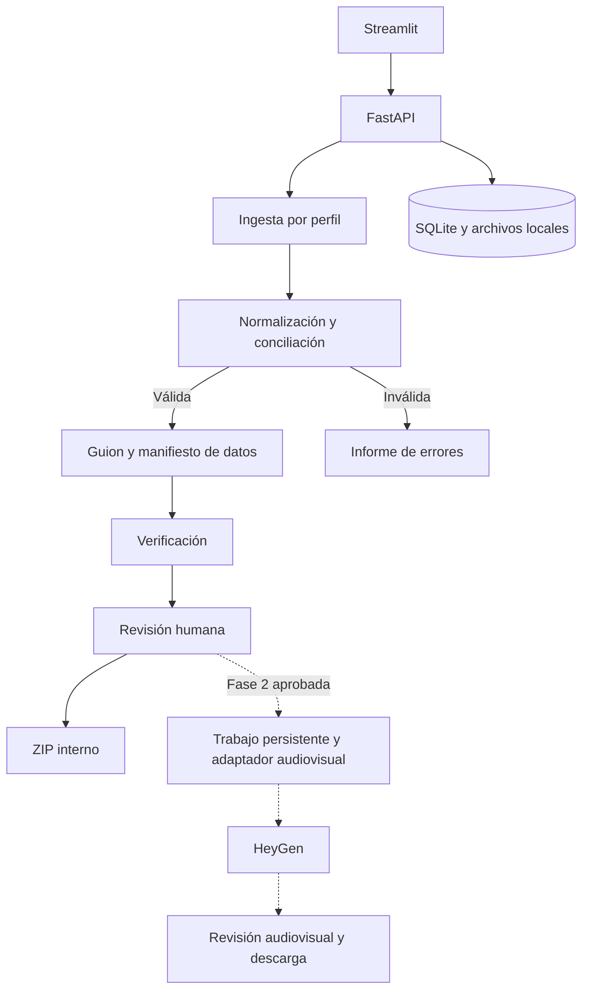

# Arquitectura

Monolito modular Python. Streamlit → HTTP local → FastAPI → casos de uso → dominio,
importadores, plantillas y persistencia. El dominio usa biblioteca estándar.

## Límites de módulos

`domain`: tipos, catálogo, conciliación y dinero. `ingestion`: estructuras y perfiles.
`scripts`: Jinja2, segmentación, verbalización y comprobación. `application`: casos de uso.
`persistence`: SQLAlchemy y migraciones. `api`: transporte. `ui`: solo cliente HTTP.
No se crean módulos audiovisuales ni de distribución vacíos.

## Persistencia

SQLite local con claves foráneas, WAL y transacciones. Un cerrojo de aplicación serializa mutaciones
en el único proceso API. Cada factura conserva una instantánea inmutable de cliente/cabecera/líneas,
además de columnas monetarias enteras y líneas normalizadas. La identidad de cliente queda embebida
en la instantánea durante el prototipo: no se mantiene un maestro de clientes editable.

Migraciones empaquetadas bajo `persistence/migrations` para que la instalación no dependa del
directorio actual. No se utiliza `create_all` como sustituto de migraciones.

## Versiones y vigencia

Archivo idéntico + perfil: se reutiliza la importación. Fuente distinta para cuenta/factura existente:
nueva versión, anterior no vigente y sus guiones obsoletos, incluso si solo cambió el formato.
Guion único por versión de factura y firma de reglas/plantilla. La firma incluye los contenidos
de código de dinero, conciliación y guion, el catálogo y los archivos Jinja2.
Se revalida al consultar, aprobar y exportar. No se permite aprobar un guion obsoleto o alterado.
Borrar una fuente posterior no reactiva aprobaciones anteriores.

## API v1

| Método | Ruta | Resultado |
|---|---|---|
| GET | /health | Estado de fase 1 y audiovisual deshabilitado |
| POST | /imports | Multipart: file, profile, synthetic_confirmed; 201 con resultado de validación |
| GET | /imports, /imports/{id} | Historial y detalle |
| DELETE | /imports/{id} | Eliminar original y derivados administrados; 204 |
| GET | /invoices?import_id= | Facturas e instantáneas |
| GET | /invoices/{id} | Detalle con errores y referencias |
| POST | /scripts/batch | JSON invoice_ids; resultado por factura |
| GET | /scripts?invoice_id=, /scripts/{id} | Guiones y revisiones |
| POST | /scripts/{id}/reviews | decision, reason, operator |
| GET | /imports/{id}/export | ZIP, guiones agrupados por estado e informe JSON |

Todas las rutas tienen prefijo `/api/v1`. Errores generales: `error.code`, `error.message`;
errores de datos incluyen fila, columna y hoja en el informe. Tamaño excedido: 413; solicitud
inválida: 422; recurso ausente: 404; operación bloqueada: 409.
Un error estructural de archivo devuelve 201 con importación RECHAZADO, porque se registra el intento.

## Evolución

PostgreSQL, autenticación y frontend especializado al cambiar el modelo operativo. Fase 2:
trabajador persistente separado y un adaptador con envío, consulta y descarga, tipos propios,
reintentos y estados inciertos explícitos. No usar sesiones de Streamlit como cola de trabajos.
